# Slack SDR Agent: n8n Decision Flow

Each chart reads **left to right**, like an n8n canvas. Every box is one node, labelled `Node type` on top and what it does underneath. Diamonds are **IF** or **Switch** nodes, and their branches are labelled the way n8n labels them (`true` / `false`, or the Switch value).

| Colour | Node type |
|---|---|
| 🟧 Orange-red, rounded | Trigger (Webhook, Error Trigger, Schedule) |
| 🟩 Dark green diamond | IF / Switch logic |
| 🟢 Light green | Supabase |
| 🟪 Purple | Slack |
| 🟠 Orange | HubSpot |
| 🔵 Blue | HTTP Request to HeyReach / Instantly / Clay |
| ⚫ Grey | Code, Respond, AI and other utility nodes |
| ▭ Double-edged box | Execute Sub-workflow |

---

## 0. The map: how the pieces hand off

Start here. Only **three things** ever start work: the `/prospect` command, a Slack button or modal, and Clay posting results back.

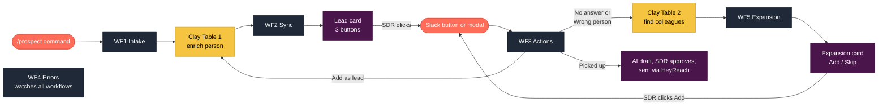

---

## 1. WF1 Intake

**Trigger:** the SDR types `/prospect <linkedin-url>`.

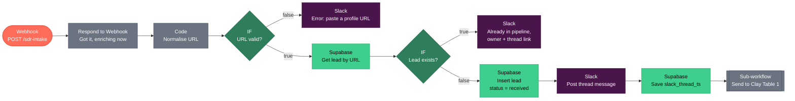

**The "Send to Clay Table 1" sub-workflow**, which WF1 and the *Add as lead* button both use:

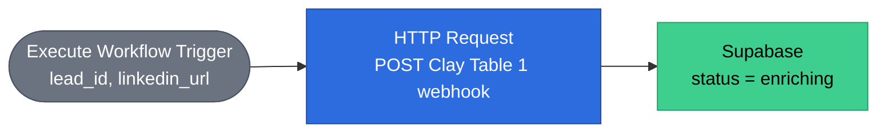

---

## 2. Clay Table 1: Enrich person

This isn't n8n. It's a Clay table, read as columns left to right.

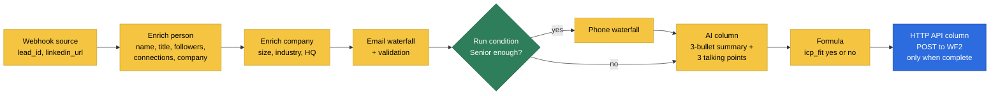

---

## 3. WF2 Sync: CRM and lead card

**Trigger:** Clay Table 1 posts the enriched lead.

```mermaid
flowchart LR
    classDef trigger fill:#FF6D5A,color:#fff,stroke:#E5533F
    classDef logic fill:#2E7D5B,color:#fff,stroke:#1F5E43
    classDef db fill:#3ECF8E,color:#000,stroke:#2DA36F
    classDef slack fill:#4A154B,color:#fff,stroke:#4A154B
    classDef hub fill:#FF7A59,color:#fff,stroke:#E5603F
    classDef util fill:#6B7280,color:#fff,stroke:#4B5563

    A(["Webhook<br/>POST /sdr-enriched"]):::trigger
    B["Respond to Webhook<br/>200 OK"]:::util
    C["Supabase<br/>Save enrichment<br/>status = enriched"]:::db
    D["HubSpot<br/>Search company by domain"]:::hub
    E{"IF<br/>Company found?"}:::logic
    E1["HubSpot<br/>Create company"]:::hub
    F["HubSpot<br/>Search contact by email,<br/>else by linkedin_url"]:::hub
    G{"IF<br/>Contact found?"}:::logic
    G1["HubSpot<br/>Update contact"]:::hub
    G2["HubSpot<br/>Create contact<br/>set SDR as owner"]:::hub
    H["HubSpot<br/>Associate + add<br/>research note"]:::hub
    I["Supabase<br/>Save HubSpot IDs<br/>status = in_crm"]:::db
    J["Slack<br/>Post lead card:<br/>Picked up / No answer /<br/>Wrong person"]:::slack

    A --> B --> C --> D --> E
    E -->|false| E1 --> F
    E -->|true| F
    F --> G
    G -->|true| G1 --> H
    G -->|false| G2 --> H
    H --> I --> J
```

---

## 4. WF3 Actions: the router

**Trigger:** every Slack button click and modal submit arrives here. A Switch node sends each one to its branch, and each branch has its own chart below.

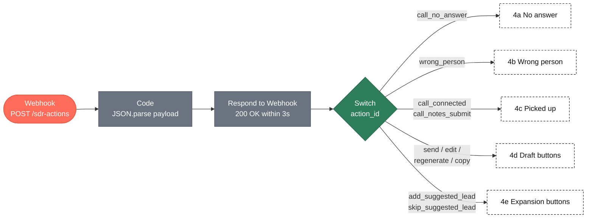

### 4a. No answer

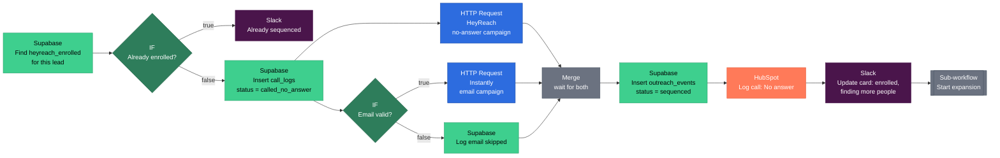

### 4b. Wrong person

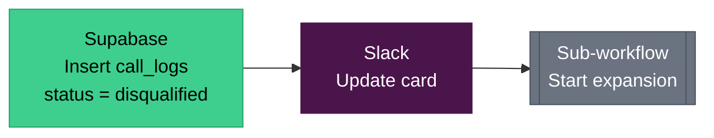

### The "Start expansion" sub-workflow

Used by both 4a and 4b.

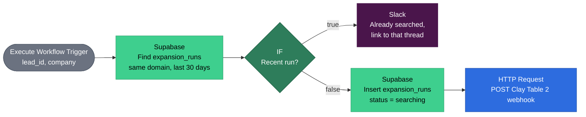

### 4c. Picked up

Two separate Slack events: the button click opens the modal, then the modal submit does the work.

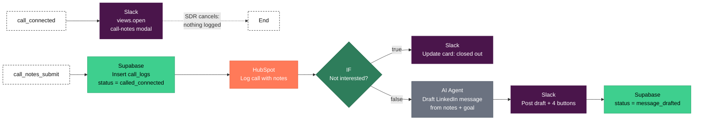

### 4d. Draft buttons

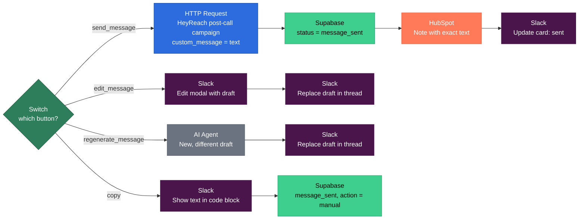

### 4e. Expansion buttons

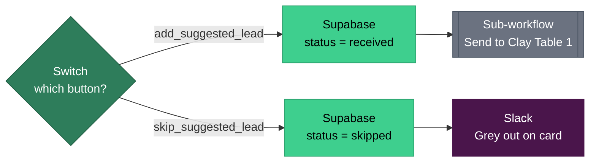

After *Add as lead*, the person goes through Clay Table 1 → WF2 like any other lead, and gets their own lead card in the same thread.

---

## 5. Clay Table 2: Account expansion

Also a Clay table, read as columns.

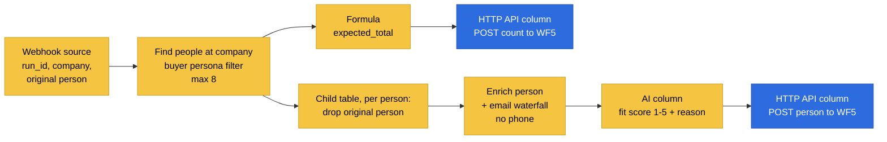

---

## 6. WF5 Expansion results

**Trigger:** Clay Table 2 posts either the count or one person.

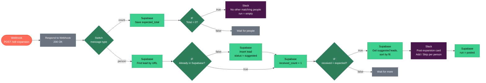

---

## 7. WF4 Errors and sweeps

Two triggers, running alongside everything.

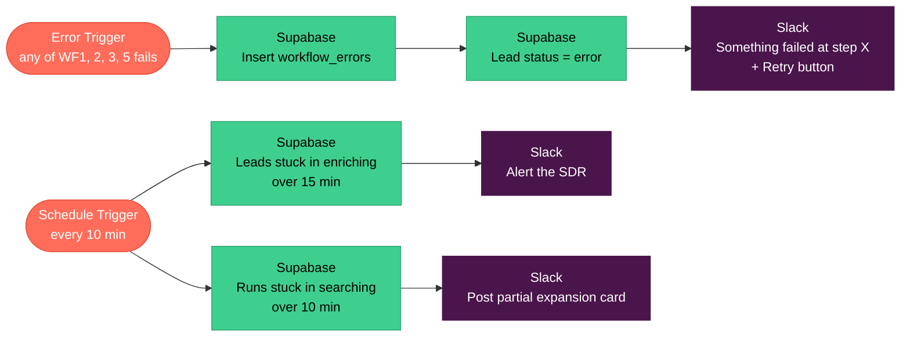
