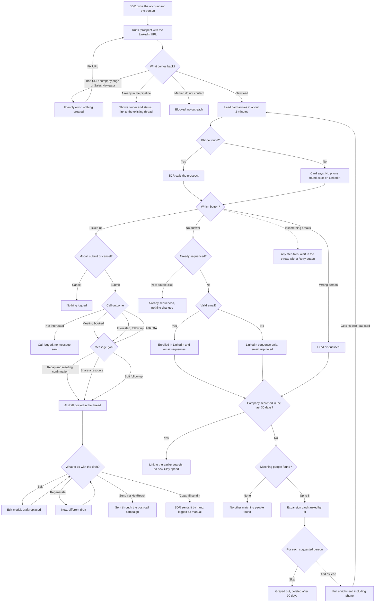

# Slack SDR Agent: Tech Stack and Flow Diagrams

## Tech stack

### Core tools

| Tool | Role | What you use from it |
|---|---|---|
| **Slack** | The interface the SDR uses | Slack app (api.slack.com/apps), `/prospect` slash command, Block Kit messages, buttons, modals (`views.open`), `chat.postMessage` / `chat.update`, Interactivity, Block Kit Builder for testing. Bot scopes: `commands`, `chat:write`, `chat:write.public`, `users:read`, `users:read.email` |
| **n8n** | Orchestrator: the only thing that writes to outside systems | n8n Cloud, or self-hosted on Railway. Nodes: Webhook, Respond to Webhook, Code (JavaScript), Switch, Set, HTTP Request, Supabase, HubSpot, Slack, AI/LLM node, Error Trigger, Schedule Trigger, sub-workflows, credentials store, Retry on fail |
| **Clay** | Enrichment, research and people search | Two webhook-fed tables. Enrich person from LinkedIn, Enrich company, email waterfall + validation, mobile phone waterfall, AI columns (research, fit score), formula columns (ICP fit, expected_total), Find people at company, HTTP API column to post back to n8n |
| **Supabase** | Source of truth | Postgres, SQL editor, 5 tables (`leads`, `expansion_runs`, `call_logs`, `outreach_events`, `workflow_errors`), indexes, Row Level Security, service-role key (kept in n8n only), views for reporting, a scheduled job for 90-day cleanup |

### Destinations

| Tool | Role | What you use from it |
|---|---|---|
| **HubSpot** | CRM for the sales team | Private App token (contacts, companies, notes, calls scopes), custom contact properties (`linkedin_url`, `linkedin_followers`, `linkedin_connections`, `research_summary`), owners, associations, call logging, notes |
| **HeyReach** | LinkedIn sequences and messages | API key (`X-API-KEY` header), `AddLeadsToCampaignV2` endpoint, two campaigns (No-answer follow-up, Post-call follow-up), custom variables (`{talking_point}`, `{custom_message}`), one connected LinkedIn sender |
| **Instantly** | Email sequences | API v2 (Bearer auth), create-lead endpoint, one No-answer email campaign |
| **LLM API** (OpenAI or Anthropic) | Writes the post-call LinkedIn message | API key, called from n8n's AI node |

### Supporting pieces

- **Languages and formats:** JavaScript (n8n Code nodes), SQL (Supabase schema and views), JSON (Block Kit, API bodies)
- **Security:** HMAC-SHA256 Slack request signing checks (with the signing secret), API keys stored only in n8n credentials
- **Hosting (optional):** Railway for self-hosted n8n (persistent volume on `/home/node/.n8n`, `N8N_ENCRYPTION_KEY` set, public HTTPS URL)
- **Submission:** Loom (demo video), exported n8n workflow JSON, README

---

## Chart 1: The entire flow

Colours: purple = Slack, pink = n8n, yellow = Clay, green = Supabase, orange = HubSpot, blue = HeyReach / Instantly, grey = LLM.

```mermaid
flowchart TD
    classDef slack fill:#4A154B,color:#fff,stroke:#4A154B
    classDef n8n fill:#EA4B71,color:#fff,stroke:#EA4B71
    classDef clay fill:#F5C542,color:#000,stroke:#C9A227
    classDef supa fill:#3ECF8E,color:#000,stroke:#2DA36F
    classDef hub fill:#FF7A59,color:#fff,stroke:#FF7A59
    classDef out fill:#2D6CDF,color:#fff,stroke:#2D6CDF
    classDef ai fill:#6B7280,color:#fff,stroke:#6B7280

    S1["SDR runs /prospect with a LinkedIn URL"]:::slack

    subgraph WF1["WF1 Intake"]
        I1["Reply within 3s: Got it, enriching now"]:::n8n
        I2{"Valid linkedin.com/in URL?"}:::n8n
        I3{"Already in Supabase?"}:::n8n
        I4["Insert lead, status received"]:::supa
        I5["Open thread in the sdr-agent channel"]:::slack
        I6["Send to Clay Table 1, status enriching"]:::n8n
    end

    S1 --> I1 --> I2
    I2 -->|No| I2x["Ephemeral error, stop"]:::slack
    I2 -->|Yes| I3
    I3 -->|Yes| I3x["Already in the pipeline, link to thread"]:::slack
    I3 -->|No| I4 --> I5 --> I6

    I6 --> C1["Clay Table 1: profile, company, email waterfall, phone waterfall, AI research, ICP fit"]:::clay

    subgraph WF2["WF2 Sync"]
        E1["Save enrichment, status enriched"]:::supa
        H1["HubSpot: upsert company and contact, set owner, associate, add note"]:::hub
        E2["Save HubSpot IDs, status in_crm"]:::supa
        L1["Lead card in thread: Picked up, No answer, Wrong person"]:::slack
    end

    C1 --> E1 --> H1 --> E2 --> L1
    L1 --> CALL["SDR makes the call"]:::slack
    CALL --> B{"WF3 Actions: which button?"}:::n8n

    B -->|No answer| N1{"Already sequenced?"}:::n8n
    N1 -->|Yes| N1x["Reply: Already sequenced"]:::slack
    N1 -->|No| N2["call_logs row, status called_no_answer"]:::supa
    N2 --> N3["HeyReach: no-answer campaign"]:::out
    N2 --> N4{"Valid email?"}:::n8n
    N4 -->|Yes| N5["Instantly: email campaign"]:::out
    N4 -->|No| N6["Log: email skipped"]:::supa
    N3 --> N7["outreach_events rows, status sequenced"]:::supa
    N5 --> N7
    N6 --> N7
    N7 --> N8["HubSpot: log call as No answer"]:::hub
    N8 --> N9["Update card: enrolled, finding more people"]:::slack

    B -->|Wrong person| W1["Status disqualified, update card"]:::supa

    subgraph EXP["Account expansion: Clay Table 2 and WF5"]
        X1{"Company searched in last 30 days?"}:::n8n
        X2["expansion_runs row, status searching"]:::supa
        X3["Clay Table 2: find up to 8 persona matches, light enrichment, AI fit score"]:::clay
        X4["WF5: dedupe, insert as suggested, count arrivals"]:::n8n
        X5{"Any matches?"}:::n8n
        X6["Expansion card ranked by fit"]:::slack
        X7{"SDR choice per person"}:::slack
    end

    N9 --> X1
    W1 --> X1
    X1 -->|Yes| X1x["Post: Already searched, link to thread"]:::slack
    X1 -->|No| X2 --> X3 --> X4 --> X5
    X5 -->|No| X5x["No other matching people found"]:::slack
    X5 -->|Yes| X6 --> X7
    X7 -->|Skip| X8["Status skipped, greyed out on card"]:::supa
    X7 -->|Add as lead| X9["Status received"]:::supa
    X9 -->|"Same flow as a new lead"| I6

    B -->|Picked up| P1["Call-notes modal"]:::slack
    P1 --> P2["call_logs connected, HubSpot call logged"]:::supa
    P2 --> P3{"Not interested?"}:::n8n
    P3 -->|Yes| P3x["Close out, no message"]:::slack
    P3 -->|No| P4["LLM drafts LinkedIn message"]:::ai
    P4 --> P5["Draft in thread, status message_drafted"]:::slack
    P5 --> P6{"SDR decision on draft"}:::slack
    P6 -->|Regenerate| P4
    P6 -->|Edit| P5
    P6 -->|Send via HeyReach| P7["HeyReach post-call campaign"]:::out
    P6 -->|"Copy, I'll send it"| P8["Shown as code block, logged as manual"]:::slack
    P7 --> P9["outreach_events message_sent, HubSpot note, card updated"]:::supa
    P8 --> P9

    subgraph WF4["WF4 Errors: runs alongside everything"]
        R1["Any failure, or a lead stuck in enriching or searching"]:::n8n
        R2["workflow_errors row, status error"]:::supa
        R3["Alert in thread with Retry button"]:::slack
        R1 --> R2 --> R3
    end
```

---

## Chart 2: The SDR's choices

Everything the SDR sees and can choose, step by step.

