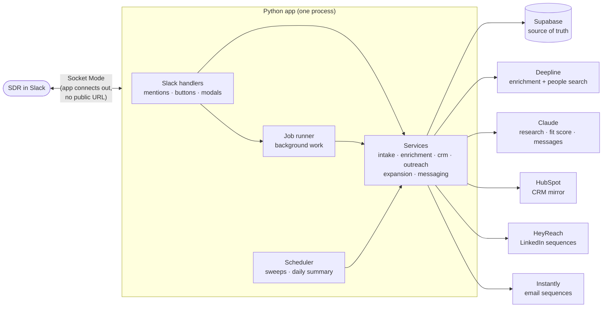
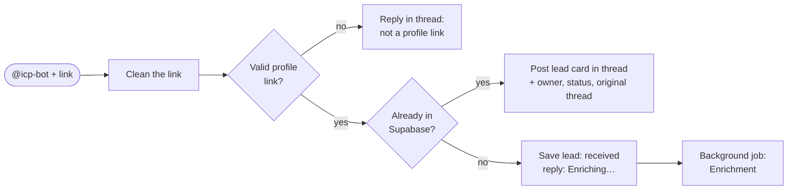
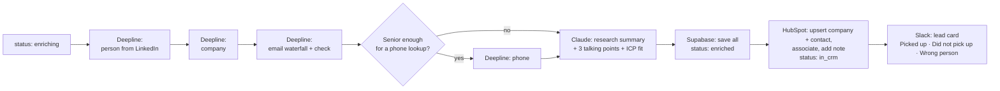
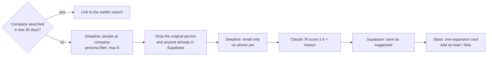
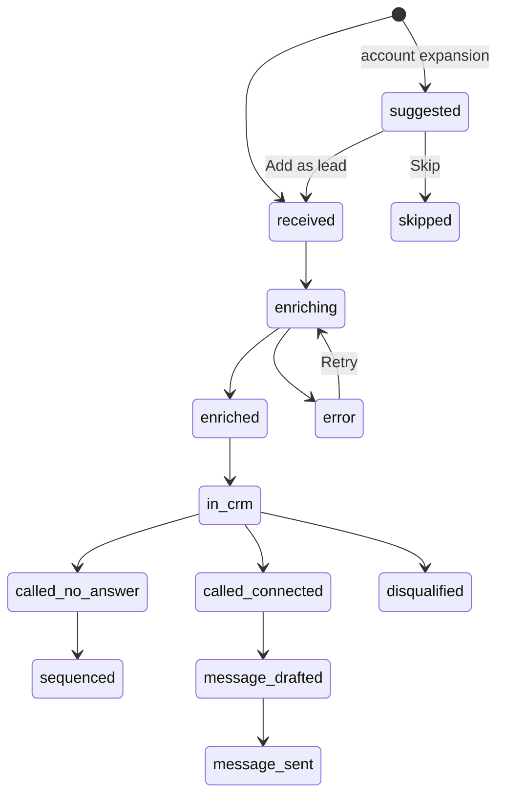

# Architecture

## In one paragraph

A single Python app connects to Slack. When an SDR mentions `@icp-bot` with a LinkedIn link, the app:
1. cleans the link and checks Supabase for the person,
2. if they're new, enriches them through Deepline and writes a research summary with Claude,
3. saves everything to Supabase, syncs it to HubSpot, and posts a lead card in the thread.

The card's buttons drive the rest: follow-up sequences (HeyReach and Instantly), finding colleagues at the same company (Deepline), and AI-drafted messages after a call (Claude).

**Supabase is the single source of truth.** Every step reads a lead's `status` before acting and updates it afterwards.

---

## The pieces

| Layer | Folder | Job | Rule |
|---|---|---|---|
| **Handlers** | `src/sdr_agent/slack/handlers/` | Receive Slack events, acknowledge them at once, and hand the slow work to the job runner | No business logic here |
| **Block builders** | `src/sdr_agent/slack/blocks/` | Turn data into Slack cards and modals (Block Kit JSON) | Pure functions, easy to test |
| **Services** | `src/sdr_agent/services/` | The business logic: what happens on each event, in what order, with which status changes | Never import Slack code. Talk to the outside world only through clients |
| **Clients** | `src/sdr_agent/clients/` | One thin wrapper per external API (Supabase, Deepline, HubSpot, HeyReach, Instantly, Claude) | Retries and timeouts live here. No business decisions |
| **Domain** | `src/sdr_agent/domain/` | Shared models, link cleaning, lead statuses and which status can follow which | No I/O at all |
| **Jobs** | `src/sdr_agent/jobs/` | Background runner (with error handling) and scheduled tasks | Every failure gets logged to `workflow_errors` and shown in the thread |

**Why these layers:** each layer can be tested on its own. Services get tested with fake clients, so the tests never call real APIs or spend credits. Swapping a vendor later, say Deepline for something else, means rewriting one client file.

---

## Main flows

### 1. Intake: someone mentions the bot

Every reply goes **in a thread under the SDR's message**. The message's timestamp (`ts`) is stored as `slack_thread_ts`, so all later updates for that lead land in the same thread.

### 2. Enrichment: a background job, about 1–3 minutes

If one lookup fails (no email found, say), the job carries on with what it has and the card says what's missing. Only a crash marks the lead `error`.

### 3. The card's buttons

| Button | What happens |
|---|---|
| **Did not pick up** | Skip if already sequenced (protects against double-clicks) → log the call → enrol in **HeyReach** and **Instantly** in parallel (Instantly only with a valid email) → log both → HubSpot call log → update the card → start **Account expansion** |
| **Wrong person** | Log it → status `disqualified` → update the card → start **Account expansion** |
| **Picked up** | Open the call-notes form **straight away** (Slack's form token expires in 3 s) → on submit: log the call + HubSpot → if *Not interested*, close out → otherwise Claude drafts a LinkedIn message → post the draft with **Send via HeyReach / Edit / Regenerate / Copy** |

### 4. Account expansion

**Simpler than the Clay version:** Python calls Deepline and waits for the answer. There's no need to count incoming webhooks before posting the card.

**Add as lead** sends that person through the full enrichment flow, which includes a phone lookup. **Skip** marks them `skipped` and greys them out. Suggested people never join a sequence automatically.

---

## Lead status

Every step checks the status before acting and changes it afterwards, so a status change is the record that a step happened.

These side exits are allowed from any state: `do_not_contact` (checked before any outreach) and `error`.

---

## Key decisions

| Decision | Why |
|---|---|
| **Slack Socket Mode**, not webhooks | Your app connects *out* to Slack, so no public URL, no ngrok and no exposed server. The trade-off: only one app process should run at a time. |
| **One Python process**: Slack listener + background thread pool + scheduler | Simple, and enough for one or a few SDRs. Supabase statuses make work recoverable: on restart, the sweeper picks up anything stuck. If it ever grows, the job runner moves to a real queue (Redis + RQ) without changing the services. |
| **Supabase is the source of truth; HubSpot is a mirror** | One place to answer "what happened to this lead". HubSpot gets what the sales team needs. |
| **Only the app writes to outside systems** | Same rule as the course doc: enrichment tools return data, the app decides what to write and where. |
| **Clients behind small interfaces** | Tests use fakes; vendors can be swapped one file at a time. |
| **Idempotency checks before every outreach action** | SDRs double-click, and Slack re-sends events if the app is slow. Check `outreach_events` and `status` before acting. |
| **Claude with structured outputs** (Pydantic models) | Research, fit scores and drafts come back as validated objects rather than text that needs parsing. |
| **A person approves every message** | The agent drafts; only a click on *Send* sends anything. |

## Data model

Same five Supabase tables as the original design: `leads`, `expansion_runs`, `call_logs`, `outreach_events` and `workflow_errors`. The SQL lives in `db/migrations/001_initial_schema.sql`. A sixth table, `sdr_owners` (Slack user ID → HubSpot owner ID), replaces the hard-coded mapping.

## Security

- Secrets are only in `.env` locally, or in the host's secret store when deployed. They're never committed, and never sent to Slack or put in prompts.
- The Supabase **service_role** key is used only by the app. Row Level Security stays on.
- Socket Mode means Slack never connects in to you. Slack's signature check isn't needed because the connection is authenticated with the app-level token.
- Opt-outs: `do_not_contact` is checked before every outreach action. Skipped suggestions are deleted after 90 days.
